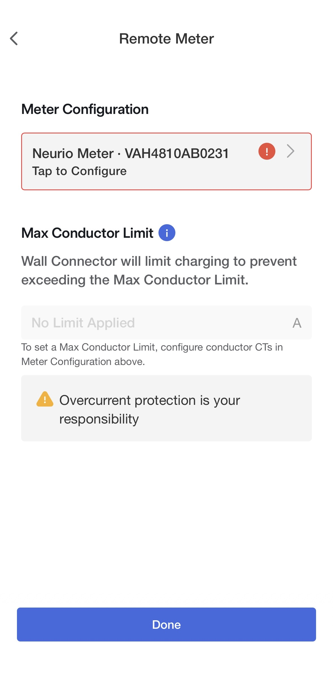
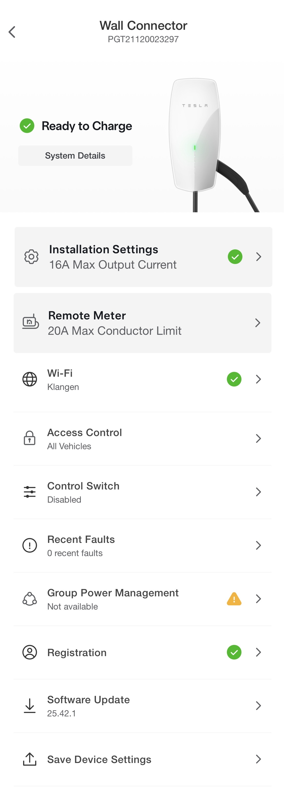
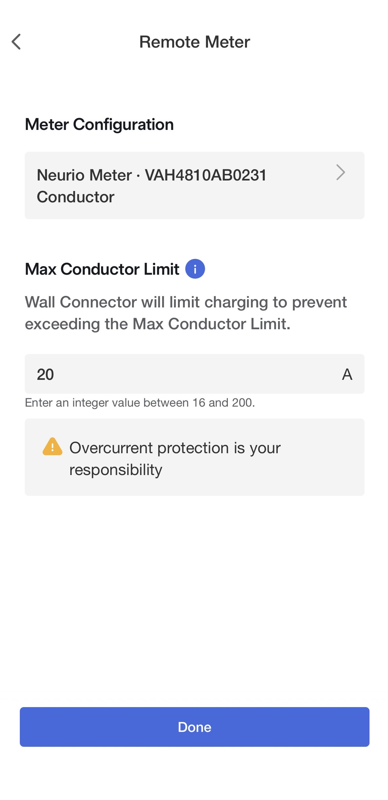

# Tesla Wall Connector Control (Gen 3)

ESPHome configuration to dynamically control a **Tesla Wall Connector Gen 3** by **emulating a Tesla/Neurio energy meter** over **RS485/Modbus**.

This configuration implements **experimental firmware 26.x feedback control**,
with four operating modes, Home Assistant and local web controls, a status LED,
and diagnostics. The charger is controlled through the emulated RS485 meter;
its local HTTP API supplies current measurements only.

Control runs on the Wall Connector and does not use a Tesla vehicle account,
Fleet API or a vehicle-specific start/stop service. It is intended for Tesla
and third-party vehicles supported by the charger. Actual regulation, pause
and restart behavior must be verified with each charger firmware and vehicle.

### Firmware 26.34.0 observations

The user's on-device tests with **Wall Connector firmware 26.34.0** indicate
that Auto load regulation appears to work as household battery charging changes
the available capacity. Overload-based pause requests can still show an
**Error** state. These are preliminary observations from one installation,
not verification of every operating mode, fault condition or third-party vehicle.

The firmware version is stated explicitly: these observations do not establish
compatibility with later Tesla firmware releases.

## Four operating modes

| `Tesla Control Mode` | Behavior |
| --- | --- |
| `Auto` | Calculates an available charging target from the worst-phase household load, main fuse, safety margin and software charge ceiling. |
| `Manual` | Regulates toward `Manual Target Setpoint`, capped by the same electrical limits. Set 0 A to request pause; a target below 6 A also requests pause. |
| `Manual Fixed` | Regulates toward the same manual setpoint, capped by `Wall Connector Max Current`. Requires fresh charger feedback, but no HA connection, house sensors or reporting helper. Bypasses household load balancing and main-fuse protection. 0 A or a target below 6 A requests pause. |
| `Solar Surplus` | Uses signed grid measurements to target the weakest phase's solar surplus. Requires stable surplus before starting; short deficits can use a configurable 6 A grace period with grid import. Electrical/data guards always win. |
| `Unregulated` | Keeps RS485 replies alive with a low, alternating meter reading. Bypasses the software target, main-fuse protection and watchdog. Tesla One's configured output ceiling and the vehicle determine actual current. |

The selected mode is restored after reboot. The old `Tesla Wall Connector Auto
Mode` switch remains for HA automation compatibility: ON selects Auto, OFF
selects Manual. Its displayed state is OFF in every non-Auto mode; use the
selector to choose between the manual modes and Unregulated. On the first
install of this version the selector defaults to Auto; the previous switch's persisted value is
not migrated. A regulated mode requests pause until valid data arrives.

`Unregulated` is an intentional opt-out: the ESP32 does not enforce even
`Wall Connector Max Current` in that mode. That number is a software ceiling
for Auto, Manual and Manual Fixed, not a remote setting for Tesla One.
Mode-specific behavior must be tested on the charger; keeping Modbus alive does not guarantee that a
particular firmware will accept the emulated meter.

Both manual modes share `Manual Target Setpoint`. For example, an 8 A request
in Manual can be reduced by household load; in Manual Fixed it remains an 8 A
target if the software ceiling permits it and no recovery cap is active.
Selecting 16 A does not guarantee 16 A actual current: the vehicle, charger
settings and feedback controller can limit the result.

| Requirement or limit | Auto | Manual | Manual Fixed | Solar Surplus | Unregulated |
| --- | --- | --- | --- | --- | --- |
| HA subscription and required meter sensors | Required | Required | Not required | Required | Not required |
| Signed power + RMS current + voltage | Optional | Optional | Ignored | Required | Ignored |
| Fresh Wall Connector feedback | Required | Required | Required | Required | Not required |
| Household fuse, safety margin and reporting guard | Applied | Applied | Bypassed | Applied | Bypassed |
| Manual slider | Ignored | Applied | Applied | Ignored | Ignored |
| Software charge ceiling and recovery watchdog | Applied | Applied | Applied | Applied | Bypassed |

All modes initially publish a boot pause request. Manual Fixed continues using
its selected setpoint when HA disconnects; editing it remotely still requires
HA or the device's local web interface.

## What this does

- Runs on an **ESP32** (ESP-IDF) with an **RS485 transceiver**.
- Acts as a **Modbus server** that the Wall Connector polls (Wall Connector = master).
- In Auto/Manual, computes an allowed charging current based on:
  - House main fuse rating (A)
  - Number of grid phases (1/2/3)
  - House load per phase (A) from Home Assistant
  - Wall Connector max current (A)
- Updates simulated Neurio values (current/power) so the Wall Connector self-regulates up/down.
- Requests pause on missing control data and applies the configured watchdog fallback during recovery once the necessary measurements are healthy.

Manual Fixed keeps a requested current across HA disconnects using the restored
setpoint. It still requires local charger feedback and applies the watchdog
fallback during recovery. It cannot guarantee exact actual amperage; charger
limits and vehicle behavior also determine the resulting current.

## Requirements

- **Tesla Wall Connector Gen 3** (with RS485/Neurio metering enabled/configured in the charger).
- **ESP32 using ESP-IDF** with a free UART + an **RS485 transceiver** (built-in or external).
- ESPHome **2026.9.0 or newer**. The current configuration compiles with 2026.9.0 and uses encrypted OTA and `channel_colors` for the LED.
- Local WiFi/LAN access from the ESP32 to the charger at `/api/1/vitals`. The API is read-only; current requests are still sent through RS485.
- Home Assistant + ESPHome (Dashboard/Add-on or CLI).
- For Auto and Manual: Home Assistant sensors that provide **per-phase current in amperes (A)**.

## Sensor requirements (Home Assistant)

For Auto and Manual, you must provide entity_ids for service-incomer current **per phase**, in
**amperes**, **including the charger's own consumption**. Auto/Manual subtract
the measured charger branch once to estimate the rest of the house. Do not
supply a house-only measurement and do not add the charger current again.
The default `Current Only` source expects nonnegative import current. For solar
installations, use the signed grid source described below; unsigned current
alone cannot distinguish import from export.

Accepted sensor types for the default Current Only source (the signed source
also requires W and V, as described under Configuration):

- ✅ `sensor.<something>_l1_current` in A
- ❌ Not power (W / kW)
- ❌ Not energy (kWh)
- ❌ Not a single “total house current” sensor that aggregates multiple phases (you need per-phase values). In a true 1‑phase installation, the single phase current effectively *is* the total.

Supported setups for Auto and Manual:

- 1-phase: only Phase 1 sensor required
- 2-phase: Phase 1 + Phase 2 required
- 3-phase: Phase 1 + Phase 2 + Phase 3 required

## Configuration

Solar Surplus and the signed grid source are new experimental additions. They
have software scenario coverage but have not yet been verified on hardware.

Most things you need to change are at the top of `tesla-wall-connector-control.yaml` under `substitutions:`:

- `house_phase1_entity`, `house_phase2_entity`, `house_phase3_entity`
- (optional) `tx_pin`, `rx_pin` for your ESP32 wiring
- `wallconn_ip`: replace `YOUR_WALL_CONNECTOR_IP` with your charger's local IP address.
- (optional) feedback/house-data timeouts and watchdog recovery timings

Find the Wall Connector's local IP in your router's connected-device list.
Enter only the address in `wallconn_ip`, without `http://` or a path; the YAML
adds `/api/1/vitals`. Verify that `http://<your-charger-IP>/api/1/vitals` returns
JSON from your network. A DHCP reservation helps keep the address stable.
The supplied IP and `sensor.your_phase1_current` / `sensor.your_phase2_current` /
`sensor.your_phase3_current` values are placeholders, not working defaults.
Replace the required phase entities in Auto/Manual; unused phase placeholders
can remain. Manual Fixed and Unregulated do not require house sensor entities.
When using the optional HA example, replace its entity list with the same
sensors too.

### Signed grid measurements and solar surplus (experimental)

For a Fronius Smart Meter at the grid interconnection point, enable **Real power
phase 1/2/3**, **Current phase 1/2/3**, and **Voltage phase 1/2/3** in HA. Other
meters can be used if they provide the same measurements. Use phase-neutral
volts, not phase-to-phase voltage. The meter must include the charger and solar
installation, and phase ordering must match the charger's feedback.

Configure these placeholders for each active phase:

| Substitution | Measurement |
| --- | --- |
| `house_phase1/2/3_entity` | Grid meter RMS current in A. |
| `grid_phase1/2/3_power_entity` | Signed real power in W: positive import, negative export. |
| `grid_phase1/2/3_voltage_entity` | Voltage from that phase to neutral in V. |

Then select **Grid Measurement Source → Signed Power + Current**. Verify signs
against known import and export first. Auto and Manual use these readings for
fuse headroom; Manual Fixed and Unregulated continue to ignore them. Selecting
Solar Surplus with Current Only requests pause with invalid-settings status.
The source selector is restored, and defaults to Current Only for compatibility.

The controller estimates active current as `P/V`, with a non-active component
from `max(0, RMS_current² - active_current²)`. Fuse capacity keeps that component
in the calculation instead of treating W/V as total current. This assumes the
EV adds approximately unity-power-factor active current. It is an experimental
estimate, not a replacement for electrical protection. Nonfinite readings,
invalid voltage/current ranges and strongly inconsistent P/V vs RMS current
request pause. Reactive power sensors are not required by this implementation.

Solar Surplus uses the **least exporting active phase**, with EV consumption
subtracted once to estimate the household balance. It does not average phases
for billing, switch phases automatically or use total inverter production.
Set Grid Phase Count to the actual charging setup and verify the phase mapping.

- **Solar Start Stable Time**: default 30 seconds of surplus above 6 A plus
  Tesla Restart Headroom Margin before starting or restarting.
- **Solar Deficit Grace Time**: default 60 seconds. Only an already charging
  solar session may hold a 6 A target during a short deficit. Grid import is
  explicitly allowed during grace. Set 0 for no grace.
- Grace ends immediately for missing/invalid data or inadequate fuse capacity.
  Once the deficit timer expires, pause is requested and stable restart is
  required. It cannot keep rearming while the car slows down.

A new EV feedback value does not repeatedly change the inferred household
balance while signed real power is unchanged. The active household estimate is
refreshed when real power changes, pairing it with the latest EV feedback. RMS
current and voltage still update electrical capacity independently. HA values are
not guaranteed to arrive as an atomic measurement, and receive time is not the
physical sample time. Slow/asynchronous meters can still cause transient
invalid readings or inaccurate estimates. Verify cadence and test load steps
before relying on this mode. `house_sensor_timeout_ms`, when enabled, applies
to current, power and voltage receive ages; enable it only with recurring
reports, including at unchanged load. For the optional reporting helper, include
**all required current, power and voltage entities** in its entity list.

Pause still uses the experimental overload-based request. This change does
**not** establish an error-free stop or reliable automatic restart on every
vehicle/firmware. Test actual contactor opening and restart on your installation.
Missing data and overload keep the protective response; no cloud grace applies.

### YAML `substitutions` reference

| Key | What it does |
| --- | --- |
| `device_name` | ESPHome device name (also used for hostname/entity_id prefixes). |
| `friendly_name` | Friendly name shown in Home Assistant. |
| `tx_pin` / `rx_pin` | ESP32 UART pins used for RS485 (connect to RS485 DI/RO). |
| `house_phase1_entity` | Home Assistant entity_id for **Phase 1 current in A** (required in Auto/Manual). |
| `house_phase2_entity` | Home Assistant entity_id for **Phase 2 current in A** (required in Auto/Manual for 2-/3-phase). |
| `house_phase3_entity` | Home Assistant entity_id for **Phase 3 current in A** (required in Auto/Manual for 3-phase). |
| `watchdog_fault_delay_ms` | Fault duration before latching recovery, initially 8 s. Missing required data requests pause immediately; this delay does not postpone that pause. |
| `watchdog_recover_delay_ms` | Continuous healthy-data recovery period before releasing the fallback cap in all four regulated modes. |
| `wallconn_ip` | Required for Auto, Manual and Manual Fixed: replace `YOUR_WALL_CONNECTOR_IP` with the local charger IP. Used to poll complete vitals snapshots every 2 seconds. |
| `vitals_timeout_ms` | Maximum age of a successful complete snapshot, initially 8 seconds. Failed polls retain the last complete valid snapshot only until this age limit; they never refresh its timestamp. |
| `house_sensor_timeout_ms` | Optional age limit for each phase's received samples. Default 0 uses HA availability and API connection; enable a timeout only if your source sends recurring unchanged readings. |
| `house_meter_reporting_entity` | Optional HA reporting helper, default `binary_sensor.tesla_house_current_reporting`. Enable its guard only after configuring and verifying the helper. |

Copy only `tesla-wall-connector-control.yaml` into your ESPHome configuration
directory (typically `/config/esphome/` in Home Assistant), alongside your
`secrets.yaml`:

```text
tesla-wall-connector-control.yaml
secrets.yaml
```

ESPHome downloads `twc_vitals` and its bundled `twc_control.h` directly from
GitHub during configuration validation/build. You do not need a local
`twc_control.h` or `components/twc_vitals/` folder. After switching to this YAML,
you can remove the old local copies if no other configurations use them.
Internet access is required for the first download or after clearing the cache.
No GitHub access is needed by the flashed device at runtime.

The `external_components` source is pinned to a specific commit with
`refresh: never`, so rebuilding the same YAML uses the same controller code.
When updating, copy the new YAML including its matching `ref`, while preserving
your own substitutions and secrets. Do not change the ref to `main`: this
experimental component lives on the test branch. See ESPHome's
[external components documentation](https://esphome.io/components/external_components/).

`examples/` contains the optional Home Assistant reporting helper, and `tests/`
contains development checks. Neither folder needs to be copied to ESPHome or
is included in the flashed firmware. The images are used by this README.

The component polls HTTP on a FreeRTOS worker task and transfers complete
snapshots through a queue; it does not block the ESPHome main loop or compute
anything inside a Modbus read.

You also need these `!secret` values for ESPHome/Home Assistant:

- `wifi_ssid`, `wifi_password`
- `api_key`
- `fallback_password`

Important: `!secret` values must exist in ESPHome’s `secrets.yaml`, or you must replace `!secret ...` in `tesla-wall-connector-control.yaml` with hardcoded strings (not recommended).

Example `secrets.yaml` (replace the API placeholder with a valid ESPHome encryption key):

```yaml
wifi_ssid: "MyWifi"
wifi_password: "secret"
api_key: "base64-key-from-esphome"
fallback_password: "another-password"
```

ESPHome 2026.9.0 or newer is required. OTA uploads require encryption with
the same `api_key` as the native API, using an uploader that supports encrypted
OTA (such as ESPHome 2026.9.0 Device Builder). A separate `ota_pw` is no longer
used by this configuration; an existing secret can remain in `secrets.yaml`.

## Hardware / wiring (overview)

This project is developed/tested using a **LILYGO T-CAN485** board (https://lilygo.cc/en-us/products/t-can485). You can absolutely use any ESP32 + RS485 setup, but you may need to update pins, power/enable GPIOs, and wiring to match your specific hardware.

This configuration uses:

- UART: `tx_pin` (default `GPIO22`) and `rx_pin` (default `GPIO21`)
  - ESP32 TX → RS485 DI
  - ESP32 RX → RS485 RO
- RS485 A/B → Wall Connector RS485 terminals (labels vary; if nothing happens, swap A/B)
- A single WS2812 status LED on `GPIO4` (optional, but configured)

Note: the YAML also defines three internal GPIO switches to power/enable RS485 hardware (`GPIO16`, `GPIO19`, `GPIO17`). If your hardware does not need these enable lines, you can remove them or hard-wire your RS485 module to power (and adjust the YAML accordingly).

## Setup photos

These photos illustrate the hardware setup and earlier controls. They do not
show every entity or mode in the current configuration.

### Home Assistant view

<p align="center">
  
</p>

### Wall Connector configuration

<table>
  <tr>
    <td align="center">
      <br>
      <sub>Unconfigured</sub>
    </td>
    <td align="center">
      <br>
      <sub>Configured</sub>
    </td>
    <td align="center">
      <br>
      <sub>Setpoint example (20A)</sub>
    </td>
  </tr>
</table>

### Transformer / RS485 wiring

<table>
  <tr>
    <td align="center">
      <br>
      <sub>1</sub>
    </td>
    <td align="center">
      <br>
      <sub>2</sub>
    </td>
    <td align="center">
      <br>
      <sub>3</sub>
    </td>
  </tr>
  <tr>
    <td align="center">
      <br>
      <sub>4</sub>
    </td>
    <td align="center">
      <br>
      <sub>Configured</sub>
    </td>
    <td></td>
  </tr>
</table>

## Home Assistant controls and sensors

After adding the device to ESPHome/HA you’ll get entities like the ones below (names may vary slightly depending on `friendly_name`).

### Controls (things you can change)

| Entity | Type | What it does |
| --- | --- | --- |
| `Tesla Control Mode` | select | Auto / Manual / Manual Fixed / Solar Surplus / Unregulated; restored after restart. |
| `Tesla Wall Connector Auto Mode` | switch | Compatibility switch: ON selects Auto; OFF selects Manual. |
| `Manual Target Setpoint` | number | Requested current in both manual modes (0 A requests pause); retained independently of mode and software max. |
| `House Main Fuse` | number | Main fuse rating in A for Auto/Manual load balancing; ignored in Manual Fixed and Unregulated. |
| `Wall Connector Max Current` | number | Software charge ceiling for Auto, Manual and Manual Fixed. Does not change Tesla One. |
| `TWC Meter Conductor Limit` | number | Must match Tesla One's **Max Conductor Limit** exactly. Separate from main fuse and max output/charge current. Initial default 16 A is an example. |
| `Tesla Safety Margin` | number | Reserved current below the main fuse in Auto/Manual, initially 1 A; configurable 0–5 A. |
| `Tesla Restart Headroom Margin` | number | Auto/Manual: extra headroom above 6 A required after a low-budget pause, initially 1 A. |
| `Tesla Restart Stable Time` | number | Auto/Manual: continuous sufficient headroom before restarting after a low-budget pause, initially 30 s. |
| `House Meter Reporting Guard` | switch | Auto/Manual: optional HA reporting/evaluation heartbeat guard. Default OFF; install and verify the example helper before enabling. |
| `Grid Phase Count` | select | Select 1/2/3 phases. Determines active simulated channels and required Auto/Manual house sensors. |
| `Grid Voltage` | select | Used for simulated power values (W). Does not change current-limit math (which is based on amperes). |
| `Tesla Watchdog Enable` | switch | Enables delayed fault latching and fallback recovery in all four regulated modes. Missing-data guards always request pause; the watchdog does not run in Unregulated. |
| `Tesla Watchdog Fallback Current` | number | Additional cap during healthy-data recovery, clamped to the charge ceiling and selected target; Auto/Manual also respect house headroom. Missing measurements request pause instead. |
| `ESPHome Log Level` | select | ERROR/WARN/INFO/DEBUG. VERBOSE is deliberately unavailable to avoid delaying Modbus replies. |
| `Auto Status LED` | switch | Enables automatic status LED behavior (polling/watchdog indication). |
| `Manual Control Status LED` | light | WS2812 LED control. If you manually toggle this light, Auto Status LED mode is turned off. |
| `<Device> Restart` | button | Reboots the ESP32. |

### Status and diagnostics (read-only)

| Entity | Type | What it shows |
| --- | --- | --- |
| `House Load Phase 1/2/3` | sensor | Current per phase (A) as received from HA, published every 2 seconds. This display cadence does not prove the physical meter sample cadence. |
| `Tesla Wall Connector Effective Setpoint` | sensor | Effective software target after limits, 0 for pause; unavailable in Unregulated. This is not measured current or the Neurio register value. |
| `Tesla Actual Charge Current` | sensor | Charger-measured current from the last valid snapshot; unavailable when it expires. |
| `Tesla Available Charge Headroom` | sensor | Estimated available charger current after household load and margin in Auto/Manual; unavailable in Manual Fixed and Unregulated. |
| `Neurio Emulated Phase A/B/C Current` | sensor | Published meter readings used to request charger behavior. |
| `Tesla Feedback Healthy` | binary sensor | Whether a complete, valid vitals snapshot is fresh. |
| `Tesla Feedback Last Failure` | text | Retains the last failed-poll reason after feedback recovers, to help correlate historical pauses. |
| `Tesla Actual Phase 1/2/3 Current` / `Tesla Contactor Closed` | diagnostic | Per-phase charger feedback and contactor state. Phase currents become unavailable when feedback expires; the contactor indicator is false then, so check Feedback Healthy too. |
| `Tesla Feedback Request Status` | text | Last request result: OK, network loss, timeout, transport/status error, buffer overflow, invalid JSON or invalid fields. |
| `Tesla Feedback Response Time` / `Tesla Feedback HTTP Status` | sensor | Latest attempt's duration and HTTP status; transport failures can report 0 or a negative status instead of an HTTP response code. |
| `Tesla Feedback Last Success Age` | sensor | Seconds since the last valid complete snapshot; unavailable before the first success. |
| `Tesla Feedback Failed Polls` / `Tesla Feedback Consecutive Failures` | sensor | Failures since boot and current consecutive failure count. |
| `Tesla RS485 Polling Active` / `Tesla RS485 Status` / `Tesla RS485 Last Poll Age` | diagnostic | Recent measurement requests from the charger; a 10 s gap is reported as lost polling. This does not prove delivery of a reply or acceptance of the emulated meter. |
| `House Phase 1/2/3 Received Value Age` | sensor | Age of values received by ESPHome, which can increase at constant load even while the actual meter remains healthy. |
| `Effective Max Charge Current` | sensor | Mirrors `Wall Connector Max Current` as a sensor for UI visibility. |
| `Tesla Auto Status` | text | Selected mode and current control state: Boot / Startup / Increase / Hold / Reduce / Overload / Pause / Waiting for stable charging headroom / Unregulated. |
| `Tesla House Load Sensor Status` | text | House sensor/guard status; explicitly reports that house load balancing is bypassed in Manual Fixed. |
| `Tesla Watchdog Status` | text | Pause request and reason, restart wait, recovery cap, disabled recovery watchdog, or Unregulated bypass. |
| `Uptime` / `WiFi Signal` | sensor | Basic device diagnostics. |

### Status LED

When auto LED mode is enabled:

- Green blink: Wall Connector is polling Modbus as expected
- Red: Wall Connector has not polled for >10s
- Blue blink: pause is requested or watchdog recovery is active. Automatic LED updates always respect `Auto Status LED`.

## How the calculation works

For each selected phase, `other_load = max(0, total_current - ev_current)`.
The charging headroom is the lowest `main_fuse - margin - other_load` across
those phases. Auto uses that headroom; Manual also caps it at the slider value.
Auto, Manual and Manual Fixed respect `Wall Connector Max Current`, floor the
effective target to whole amps, and request pause below 6 A. Manual Fixed uses
`min(manual_target, max_charge)` without calculating household headroom; the
headroom sensor is unavailable in that mode. The controller does not promise
instantaneous or exact current: actual behavior is decided by the charger's firmware and car.

In Auto and Manual, after a low-budget pause, restart requires `6 A + Tesla Restart Headroom Margin`
of house headroom continuously for `Tesla Restart Stable Time`. Defaults are
1 A and 30 seconds (7 A for 30 s). A budget dip or missing required input resets
the timer; reductions and pauses remain immediate. The manual slider and
watchdog fallback can remain at 6 A: the margin applies to the house budget,
not those requested currents. Manual Fixed does not use this restart wait;
a valid manual request at or above 6 A can resume immediately unless fault
recovery imposes a cap. These settings are adjustable and restored in
the web UI/HA. The margin only controls restarting, not ongoing 6 A charging.

The feedback controller replaces the old `fake_load = fuse - target` formula
and removes the `-0.01 A` UI workaround. It uses Tesla One's conductor limit `L`:

- Idle: advertise `max(0, L - target)` to permit a session to start.
- Increase: track `L + actual_current - target` below the limit. Release of a
  previous constraint is limited to 2 A/s; protective rises pass immediately.
- Hold near the requested target: publish `L - 0.25 A`.
- Reduce: publish `L + 0.9 A`. A deviation greater than 1 A must persist for
  8 seconds, except a deviation of 3 A or more acts immediately.
- Electrical budgets override that tolerance and delay. In Auto/Manual,
  consumption above fuse-minus-margin triggers immediate reduction and above
  the main fuse triggers a hard reduction request at `L + 1.2 A`. The software
  charge ceiling triggers immediate reduction in all four regulated modes.
- Pause, boot, or missing regulated-mode inputs: publish `L + 1.2 A`.
- Every active channel has a time-based +/-0.05 A dither. It is not a freshness
  heartbeat and does not prove that the meter is trusted.

During the initial multi-phase engagement, each phase can publish its own
charger-correlated value for up to 15 seconds so idle phases retain startup
headroom. Protective reductions always take precedence. Afterwards the common
constraint is published on all selected phases; unselected channels are zero.
When a nonzero house-sample timeout is configured for a periodically reporting
source, a large house-current drop requires two received samples to agree.
Changed-only HA sources accept drops immediately so a single stable change
does not leave the old high value stuck forever. Rises are always immediate. Service current is floored at the measured EV branch
before calculating household load, to handle temporarily lagging meter samples.
House-current processing only affects Auto and Manual; Manual Fixed ignores it.

These are experimental starting parameters based on community observations,
not an official Tesla protocol or a verbatim port of another project. In
particular, Auto's household/EV subtraction can be affected by unsynchronized
measurements. A true overload may lead to a full charging stop. Near 6 A,
vehicle-specific behavior and ripple can also stop sessions.

## Watchdog and missing data

Auto and Manual require an HA state subscriber, valid house-current sensors
for every selected phase, and a complete fresh charger snapshot.
Manual Fixed requires only the charger snapshot and valid control settings;
house sensors, the reporting guard and HA connectivity do not constrain it.
A logger-only API client does not satisfy the Auto/Manual HA guard. Lost HA
connection clears received house state so reconnecting requires new readings. Incomplete JSON, nonnumeric
or invalid currents, failed HTTP requests and expired snapshots never silently
reuse old feedback as a new sample.

Missing required data requests pause immediately. The configured fault delay
controls watchdog latching, not a grace period that allows blind charging.
When latched, continuous healthy data is required for the recovery period;
during it the fallback current caps the selected target and software ceiling.
Auto and Manual additionally limit it by household headroom.
Disabling the watchdog skips this latch/recovery behavior; it does not permit
regulated modes to operate without their required measurements. Unregulated
bypasses both. Manual Fixed has no household overload protection, even when
house sensors are available. Choose its current to suit your installation.

HA often pushes only changed values. Therefore an unchanged finite house value
is not automatically stale. This version removes the old cached-value keepalive
and the old change-based freeze test. With the default zero house timeout, a
meter that stays incorrectly available with a frozen numeric value cannot be
detected; a genuine source heartbeat is needed to enable stricter freshness.

### Optional house-meter reporting guard

`House Meter Reporting Guard` defaults OFF. Before enabling it, install the
Home Assistant example in [examples/ha-house-meter-reporting.yaml](examples/ha-house-meter-reporting.yaml)
into HA's `template:` configuration, not into ESPHome. Merge into any existing
`template:` list. Adapt the entity list to the selected grid phases and check
the resulting entity ID against `house_meter_reporting_entity`.

The example evaluates every 5 s and requires each selected sensor's
`last_reported` to be less than 45 s old. Unlike `last_changed`, this can track
reports with unchanged values when the integration writes them to HA.
Verify this happens for your meter at constant load and adjust the 45 s
threshold to its real reporting interval. MQTT sensors may require
`force_update`. A cached/replayed HA report is not proof of a new physical
measurement; use a genuine source heartbeat if your integration provides one.
See [HA state timestamps](https://www.home-assistant.io/docs/configuration/state_object/).

The helper also publishes a changing `checked_at_ts` attribute. ESPHome
requires this evaluation heartbeat to arrive within 15 s as well as the helper
state being `on`. A helper that becomes unavailable, stops evaluating, or
reports an old meter pauses Auto and Manual. The guard does not trigger in
Manual Fixed or Unregulated. Do not switch it on before the helper has been verified.

HTTP requests use a 2 s timeout on the background task. Failed responses retain
the last complete valid snapshot until `vitals_timeout_ms` expires (8 s by
default). Before the first valid response, feedback is unavailable. Request
status, HTTP status and response time always describe the latest attempt,
even while control uses the previous valid snapshot. Logs include the error category,
HTTP status, transport error and duration, and announce recovery. All
diagnostic counters reset on ESP restart. Grid Voltage now restores its saved
selection and applies that voltage to the emulated power registers.

### Pause behavior and app readings

Pause requests currently advertise a meter overload at `L + 1.2 A`; the
controller does not send a dedicated charger stop command. This can produce
an **Error** state in the charger or Home Assistant. A clean, vehicle-independent
pause mechanism has not been established. Restart hysteresis reduces repeated
low-headroom pause/restart cycles but does not remove this limitation.

An app's selected or available current is not proof that the vehicle is drawing
that current. Compare actual current, charging power and session state. Likewise,
`Startup` means the controller is permitting or helping a session start; it does
not confirm that charging has begun. A software target of 0 A means **pause
requested**, not a confirmed open contactor or zero current.

## Supervised firmware 26.34.0 bring-up

For the new signed grid source, verify import/export sign, RMS current, voltage,
phase mapping and actual update cadence. Test Auto with both import and export,
then a real load increase and an EV current decrease. Record the raw source
entities as well as controller diagnostics to detect mismatched sample times.
For Solar Surplus, test stable start, a short deficit with bounded grace,
a sustained deficit reaching pause, and stable restart. During grace verify
actual current reduces toward 6 A and observe temporary grid import. Inject a
missing power/current/voltage value and expired charger feedback to confirm
immediate protective pause rather than cloud grace. Test with grace 0 too.
The software timers do not prove that the charger honors the requested current.

1. Confirm the HA entity IDs, phase count and charger IP. The entities in the
   YAML are the main branch's originals; adapt them to your actual meter.
2. In the web UI/HA, set the real main fuse, charge ceiling, safety margin and
   **TWC Meter Conductor Limit**, matching **Max Conductor Limit** in Tesla One.
   Keep the emulated meter commissioned. Defaults are not installation facts.
3. With feedback healthy, test Manual steps such as 13 → 20 → 8 → 6 A within
   your installation's limits. Compare requested, effective, actual and
   emulated currents; check for oscillation or contactor cycling.
4. Test Auto under normal household load changes and verify each phase's total
   current, including startup and a car that uses fewer phases than the site.
5. Test Manual 0 A, HA disconnection, unavailable house sensors and blocked
   vitals access. Confirm actual charging responds to the pause request, then
   verify recovery with the configured fallback cap.
6. Test Manual Fixed at 8 and 16 A within installation limits, including an HA
   disconnect and unavailable house sensors. Verify the requested target remains
   active, while expired charger feedback requests pause.
7. Test Unregulated and return to Auto/Manual. Confirm it is Tesla One's
   ceiling that applies in bypass, and that missing regulated-mode data pauses
   after returning. Check mode and numeric settings survive restart.

If the charger ignores a reduction or pause request, stop the test and do not
rely on this implementation for load management. The complete firmware/vehicle
test matrix has not been verified; passing software tests is not hardware
certification. HTTP runs off the main loop, but WiFi/API latency, measured
reaction thresholds and sustained sessions still need to be checked on-device.

## Quick start

1. Install ESPHome 2026.9.0 or newer. Copy the YAML and provide the secrets.
   ESPHome downloads the pinned component from GitHub automatically.
2. Set the charger IP, hardware pins and phase count. For Auto/Manual, replace
   the house entity IDs with your actual per-phase current sensors.
3. Validate and install through ESPHome. Use USB for the first installation;
   later OTA uploads require an encrypted-OTA-capable uploader.
4. In the web UI/HA, check the electrical limits and match `TWC Meter Conductor
   Limit` to Tesla One's `Max Conductor Limit`. Defaults and restored values
   must be checked against the installation. Choose the desired control mode.
5. Verify charger feedback and RS485 diagnostics, then perform the supervised
   tests above. Install and verify the HA reporting helper before enabling its
   guard. Change its entity list whenever you change the house sensor IDs.

If you run via CLI locally:

```bash
esphome config tesla-wall-connector-control.yaml
esphome run tesla-wall-connector-control.yaml
```

When updating an existing installation, preserve your corrected sensor IDs.
A changed README or test file does not need to be copied to the device; firmware
changes require copying the updated YAML with its matching component ref and
installing again. The HA helper belongs in HA's configuration, not in ESPHome.

## Troubleshooting

- `Can't convert 'unavailable'/'unknown' to number`: expected when a house meter
  restarts or goes offline. Auto/Manual invalidate that phase and request pause;
  recovery requires numeric readings again. Manual Fixed ignores house sensors.
- A house display still shows an old value: the `House Load Phase` display
  templates refresh every 2 s. Control receives source updates immediately;
  inspect sensor status and received-value ages for invalid data.
- An occasional HTTP warning followed by recovery: inspect last-success age,
  rather than only the latest request status. A valid snapshot remains usable
  for less than 8 s by default; failures never extend that time. WARN messages
  are real request failures and appear at INFO as well as DEBUG. DEBUG adds
  details such as WiFi roaming and low-level transport logs.
- `Startup` with a 16 A target and little actual current: the controller permits
  charging, but the vehicle may be waiting, scheduled, disconnected or limited.
  Check the vehicle and charger session state before assuming regulation failed.
- `Error` during a pause: see the overload-based pause limitation above. Verify
  actual current falls and that charging can recover; the error text alone does
  not establish the cause of every charger fault.
- Pause in Manual Fixed: inspect charger feedback and control settings; house sensors are not required.
- Pause in Auto/Manual: inspect mode/watchdog status, house-sensor availability, charger IP and `Tesla Feedback Healthy`. Verify current sensors include the charger and report amperes.
- Red LED / no Modbus polling: verify RS485 wiring, swap A/B, ensure a common reference/ground where required, and confirm UART pins.
- Frequent feedback failures: check charger WiFi and `/api/1/vitals`. Increase `vitals_timeout_ms` only after measuring normal latency; failed attempts do not extend the last valid snapshot's lifetime.
- Frequent house-age faults: leave `house_sensor_timeout_ms: "0"` unless your source really sends recurring unchanged samples.

## Warning

Working on electrical panels and EVSE wiring involves **dangerous voltages**. Follow local regulations and use a qualified electrician when required.

## Acknowledgements

Thanks to the community members whose implementations, measurements and
tuning reports informed this project's firmware 26.x controller:

- **grescho** — shared the hold band, current tolerance, persistence delay,
  dither and fall-rate tuning used as references for reducing oscillation and
  repeated contactor cycling. See [forum post 113](https://community.home-assistant.io/t/tesla-wall-connector-gen-3-via-esphome-rs485-dynamic-current-control-no-wifi/985613/113).
- **PVi1** — published charger reaction measurements and feedback-based
  control work in [esphome-twc-control](https://github.com/PVi1/esphome-twc-control),
  which informed the use of actual charger current and distinct control zones.
- **Zany / zany92** — published [Tesla LoadPilot](https://github.com/zany92/tesla-loadpilot)
  and shared measured meter-emulation behavior, dither and reduction-band
  findings that informed this adaptation.
- **olaliv** — shared firmware 26.34.0 observations and limitations near the
  minimum charging current. See [forum post 114](https://community.home-assistant.io/t/tesla-wall-connector-gen-3-via-esphome-rs485-dynamic-current-control-no-wifi/985613/114).

These contributions are references for this adaptation; they do not imply
that their authors reviewed or validated this implementation.

Thanks also to the authors of the earlier meter-emulation reference gists:

- [TooMuchAir](https://gist.github.com/TooMuchAir/a031566aeb1e6bcd882e7c9a0f6a80a6)
- [LucaTNT](https://gist.github.com/LucaTNT/4adf01a7252386559070023612efa117)

## Development checks

Solar start/grace controls are separate from the original load-budget restart
delay. The optional reporting guard applies in Solar Surplus too.


```bash
clang++ -std=c++17 -Wall -Wextra -Werror tests/twc_control_test.cpp -o /tmp/twc-control-test
/tmp/twc-control-test
python3 tests/twc_vitals_test.py
python3 tests/ha_reporting_test.py
esphome config tesla-wall-connector-control.yaml
esphome compile tesla-wall-connector-control.yaml
```

The scenarios cover all five modes, signed import/export, non-active current,
solar start/deficit timers and unchanged-meter/EV-ramp behavior, house measurements including the EV,
uneven phases, manual tolerance/persistence, electrical limits, pause, watchdog
recovery, input expiry, mode transitions and millis rollover. Passing them
checks the software requests. The vitals tests cover retained snapshots,
expiry, request diagnostics, recovery and clock rollover with host-side stubs.
The HA helper tests require Python packages `jinja2` and `pyyaml`. Validation
and compilation require ESPHome, valid local secrets and network access for
the initial GitHub component download. For local component development, replace
the Git source with `source: {type: local, path: components}` and remove
`refresh: never` in a separate development copy of the YAML. These checks do not
contact or flash the charger, model its regulation behavior or prove acceptance
of the emulated meter.

Community references used for this adaptation:

- [Forum updates 105–114](https://community.home-assistant.io/t/tesla-wall-connector-gen-3-via-esphome-rs485-dynamic-current-control-no-wifi/985613?page=6)
- [PVi1's feedback / zone-steering implementation](https://github.com/PVi1/esphome-twc-control)
- [Tesla LoadPilot's meter emulation and measured behavior](https://github.com/zany92/tesla-loadpilot)
